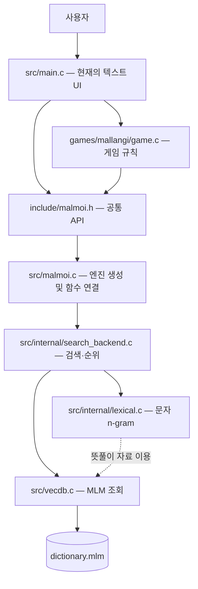
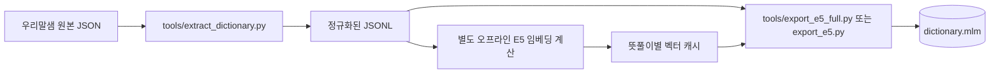
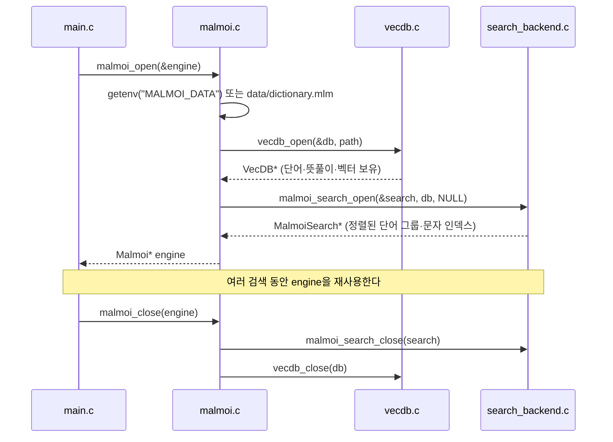
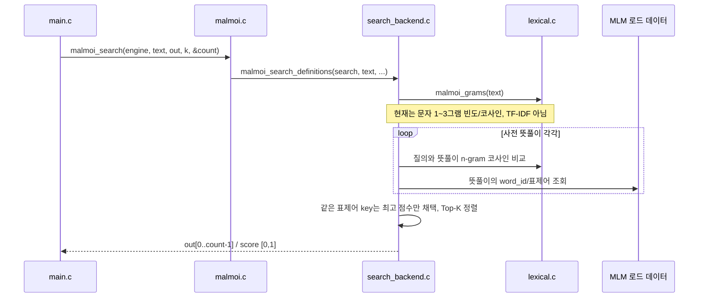
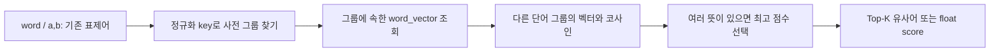

# Malmoi 아키텍처

> 기준: `main`의 기존 C 엔진 및 2026-11-04 구조 정리. **구현 완료**와 **미결정/계획**을 구분한다. 이 문서는 프로젝트의 단일 구조 설명서이며, API 호출 세부 규약은 [API.md](API.md)에 둔다.

## 1. 지금 무엇을 만들고 있나

- **세 기능:** 설명으로 단어 찾기(역방향 사전), 단어로 유사어 찾기, 말랑이 유사도 게임.
- **계산 주체:** C11 엔진. 사용자 실행 중 Python, ONNX, 네트워크를 요구하지 않는다.
- **데이터:** 별도로 생성한 `.mlm`에 표제어·뜻풀이·미리 계산한 임베딩이 들어 있다. 신경망 모델 자체가 저장된 것은 아니다.
- **UI:** [Figma 원안](https://www.figma.com/design/qPAloPFOBlIWVaWvmZVFfY/malmoi)은 존재하지만, 구현 프레임워크와 로컬/원격 배치는 **미결정**이다.
- **기본 실행:** CLion/CMake의 `malmoi`는 `src/main.c`를 통해 메뉴를 표시한다. 기존 Makefile 예제와 게임 단독 `main`은 CI·호환성 검사용으로 당분간 보존하며, CMake 기본 빌드에는 포함하지 않는다.



`main.c`는 입력·출력만 담당한다. 나중에 웹/GUI로 바뀌어도 `malmoi.h` 뒤쪽의 검색 코드를 UI에 맞춰 다시 작성하지 않는 것이 원칙이다.

## 2. 실제 파일과 소유 경계

```text
malmoi/
├── CMakeLists.txt           CLion의 기본 빌드: 실행 파일 malmoi
├── Makefile                 기존 CI/회귀 테스트의 빌드(전환 전까지 유지)
├── include/
│   ├── malmoi.h            기능 담당자/UI가 사용하는 공개 API
│   ├── vecdb.h             사전 레코드·벡터 조회를 위한 저수준 API
│   └── malmoi_search.h     기존 코드를 위한 호환용 헤더
├── src/
│   ├── main.c              기본 앱의 유일한 진입점(CMake 대상 기준)
│   ├── malmoi.c            엔진 수명·공개 함수 연결
│   ├── vecdb.c             .mlm 파일 파싱/데이터 소유
│   └── internal/
│       ├── search_backend.h/.c   검색 상태/유사도/Top-K
│       └── lexical.h/.c          문자 n-gram 추출/비교
├── games/mallangi/
│   ├── game.h/.c           게임 상태 및 입력 판정 — 담당자 작업 위치 유지
│   ├── similarity.h/.c     게임→공개 유사도 API 어댑터(현존)
│   ├── main.c              기존 단독 게임 진입점(CMake 기본 대상 제외)
│   └── engine_test.c       기존 검사 코드
├── examples/               기존 CLI·데모·검사 도구(기본 앱 대상 제외)
├── tests/                  기존 회귀 테스트(삭제하지 않음)
├── tools/                  오프라인 Python 데이터 전처리/실험 도구
├── data/dictionary.mlm     저장소의 작은 synthetic 예제 사전
└── docs/API.md             정확한 함수 계약
```

**현재 합의:** `include/`(헤더), `src/`(공통 코어), `games/mallangi/`(게임 담당자 코드)를 유지한다. 역방향 검색·유사어 담당자를 위한 빈 `features/` 폴더나 전달만 하는 래퍼는 만들지 않는다. 실제 새 기능 코드가 생길 때 담당자와 경로를 정한다. 기존 테스트를 삭제하면 CI와 호환성 검증이 깨지므로 **기본 제품 코드에서 제외하되 저장소에는 보존**한다.

헤더는 같은 역할이 아니다: `malmoi.h`는 사용자용 계약, `vecdb.h`는 데이터 계층 계약, `search_backend.h`·`lexical.h`는 엔진 내부 계약, `game.h`는 게임 전용 상태 계약이다.

## 3. 가장 중요한 정보 흐름: 데이터 생성 → 엔진 → 결과

### 3.1 데이터 제작(개발 시, Python 사용 가능)



`export_e5_full.py`는 **이미 생성된 임베딩 캐시를** `.mlm`으로 직렬화하는 도구다. 사용자가 사전 검색을 할 때 모델을 실행하는 코드가 아니다. 캐시 계산과 추론용 `tools/embed_query.py`도 기본 앱 실행 경로에는 없다. 현 E5 내보내기는 뜻풀이 임베딩을 `.mlm`의 **word vector 슬롯**에 기록한다. 이름이 `word_vector`여도 단어 철자만을 임베딩했다는 뜻이 아니다.

### 3.2 엔진 열기: 누가 메모리를 소유하나



주요 객체/변수의 의미:

| 값/변수 | 만들어지는 곳 | 쓰이는 곳 | 소유·유효 기간 |
|---|---|---|---|
| `MALMOI_DATA` | 사용자 환경 변수(선택) | `malmoi_open()` | 사전 파일 경로를 정함. 없으면 작업 디렉터리 기준 `data/dictionary.mlm` |
| `Malmoi *engine` | `malmoi_open()` | 공개 API 호출 모두 | 호출자가 `malmoi_close()`로 해제. 검색할 때마다 새로 열지 않음 |
| `VecDB *db` | `vecdb_open()` | 검색 및 레코드·벡터 조회 | `Malmoi` 내부에서 소유. 닫을 때 해제 |
| `MalmoiSearch *search` | `malmoi_search_open()` | 세 검색 API | `Malmoi` 내부에서 소유. 정렬한 표제어 그룹과 검색용 사전 상태를 보유 |
| `VecDBWord` / `VecDBSense` | `.mlm` 로더 | 표제어·뜻풀이 조회 | 엔진이 소유한 데이터를 가리키는 읽기 전용 뷰 |
| `MalmoiResult out[k]` | 호출자(앱/게임) | 출력/정렬된 결과 조회 | **배열은 호출자 소유**; 안의 `word`·`key` 포인터는 엔진 소유. `close()` 후 무효 |
| `size_t count` | 호출자 | 검색 API가 작성 | 실제 반환된 결과 개수(`k` 이내). 미등록 단어·오류는 상태 코드로 구분 |
| `GameState game` | 게임 진입점 | `submit_guess()` | 현재 게임의 `answer`, `attempts`, `usedWords`, `usedCount`, `finished`, `won`, `engine` 포인터 저장. 엔진을 소유하지 않음 |

### 3.3 역방향 검색: 설명 → 표제어



**실제 데이터 이동:** `text`(UTF-8) → 질의의 문자 조각 목록 → 각 뜻풀이에서 미리 준비한 문자 조각 목록과 비교 → 뜻풀이의 `word_id`로 표제어 연결 → 같은 정규화 `key`의 중복 제거 → `MalmoiResult` 배열. 현재 C에서는 E5를 호출하지 않으며 **TF-IDF도 아직 없다**. Python의 `tools/lexical_search.py`만 별도로 2~4그램 TF-IDF/역색인을 구현한다.

### 3.4 유사어 및 단어쌍: 단어 → 저장 벡터 비교



- `malmoi_similar(engine, word, out, k, &count)`: 입력 단어를 찾고 다른 단어들의 저장 벡터와 비교한다. **단어별 최고 점수만** 반환하고 자기 단어는 제외한다.
- `malmoi_similarity(engine, a, b, &score)`: 두 단어의 저장 벡터 간 최고 코사인만 돌려준다.
- 이 두 API의 점수는 **[-1, 1] 범위의 코사인**, 위 역방향 문자 점수는 **[0, 1]**이다. 서로 같은 확률이나 정확도로 해석하면 안 된다.
- `word_id`는 사전 데이터셋 안에서만 안정적이다. 다른 `.mlm`을 배포한 뒤에도 같은 ID가 같은 단어라는 보장은 없다.
- `MalmoiResult.word`·`.key`는 새 문자열을 할당해 넘기는 게 아니라 **엔진이 보유한 문자열 포인터**다. UI에서 `malmoi_close()` 뒤에도 사용하려면 별도로 복사해야 한다.

### 3.5 말랑이: 입력값과 게임 상태

`main.c`가 정답을 설정하고 `GameState`를 만든다. `games/mallangi/game.c`의 `submit_guess(&game, guess)`가 중복 입력·정답·사전 등록 여부를 판단하고, 오답에 한해 `malmoi_similarity()`로 실제 벡터 유사도를 구한다. `GameResult`의 `status`와 `similarity`를 앱이 출력한다. 게임 상태는 `GameState`에, 검색 데이터는 계속 `Malmoi *engine`에 있으므로 **게임과 검색 코어는 별도로 유지**된다.

현재 통합 CLI는 데모 정답으로 `이슬비`를 사용하며 `MALLANGI_ANSWER`로 바꿀 수 있다. **정답 선정·일일 게임 운영 정책이 구현되었다는 의미는 아니다.**